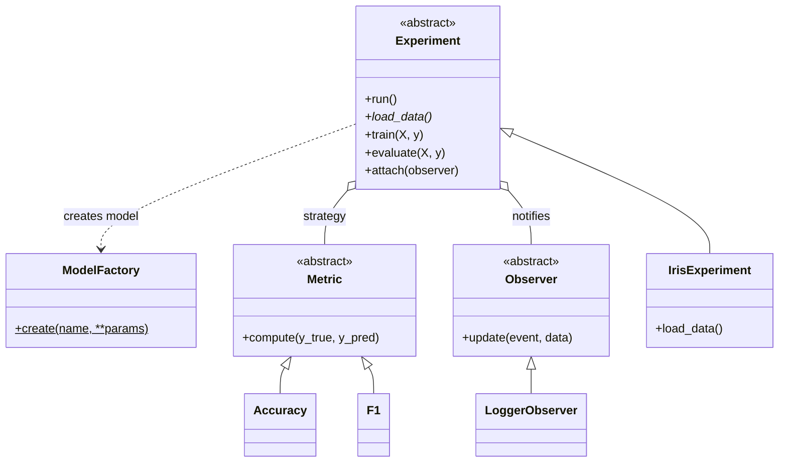

# Mini framework for ML experiments

A small Python framework for running scikit-learn experiments, built around design patterns.

| Pattern | Where |
|---|---|
| Factory | `ModelFactory` creates linear / tree / kNN models |
| Strategy | `Metric` -> `Accuracy`, `F1` |
| Observer | `Observer` -> `LoggerObserver` monitors training |
| Template Method | `Experiment.run()` fixes the flow: load -> train -> evaluate |
| Decorator | `@timed` measures training time |

## Run

```bash
pip install scikit-learn pytest
python framework.py     # demo on the iris dataset
pytest                  # 9 tests
```

## Class diagram



## Use of AI tools

I used Claude to generate code layout, tests and this README from the assignment description. I then ran the tests and the demo, and checked that each pattern is implemented as intended.
